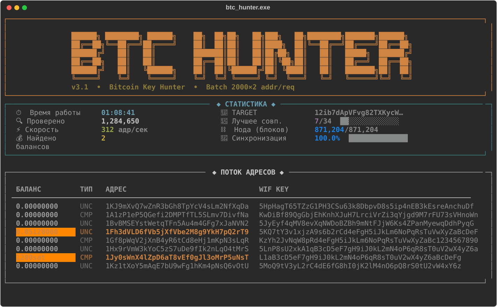

<div align="center">


# BTC Key Hunter

**Генератор и batch-сканер биткоин-адресов с живым TUI-дашбордом**

[](LICENSE)


[](../../releases/latest)

[Скачать EXE](../../releases/latest) · [Запуск из исходников](#запуск-из-исходников) · [Настройка Bitcoin Core](#настройка-bitcoin-core)

</div>

---

## Что это

Программа генерирует случайные приватные ключи secp256k1, выводит из них
Bitcoin-адреса (compressed и uncompressed) и батчами проверяет их баланс через
RPC твоей локальной ноды **Bitcoin Core** (`scantxoutset`). Всё находки
сохраняются в файл, с подтверждением звуком.

> **Важно понимать математику.** Пространство приватных ключей — 2²⁵⁶.
> Шанс когда-либо наткнуться на адрес с реальным балансом статистически
> неотличим от нуля, даже проверяя миллиарды ключей в секунду. Это проект
> для изучения криптографии биткоина, работы с Bitcoin Core RPC и построения
> быстрых TUI-интерфейсов на Python — не стратегия заработка.

## Скриншот

<div align="center">

</div>

## Возможности

- 🎯 **Список целевых адресов** — `targets.txt` рядом с программой, один адрес на строку (см. ниже)
- ⚡ **Batch-сканирование** — тысячи адресов за один RPC-запрос (`scantxoutset`), оба формата адреса (compressed + uncompressed) разом
- 🖥 **Живой дашборд** на [Rich](https://github.com/Textualize/rich) — скорость, счётчик, лучшее совпадение с таргетом, синхронизация ноды
- 📝 **Логирование** всех событий в `btc_hunter.log`
- 💰 **Автосохранение** находок (полный адрес + WIF + приватный ключ) в `ADDRESSES_WITH_BALANCE.txt`
- 🔔 **Звуковой сигнал** при находке ненулевого баланса
- 🏷 **Заголовок окна** с живой статистикой (скорость, счётчик)
- 📦 Собирается в один **portable .exe** без установки Python

## Скачать

Готовый `.exe` для Windows — на странице **[Releases](../../releases/latest)**.
Python не нужен, запускается сразу.

> EXE работает **только локально с твоей Bitcoin Core** — см. ниже. Если
> скинуть exe другу, у него должна быть своя синхронизированная нода с теми
> же RPC-настройками (или собственными, см. `RPC_*` в начале скрипта).

## Целевые адреса (targets.txt)

При первом запуске рядом с программой (или с `.exe`) создаётся `targets.txt`:

```
# Один биткоин-адрес на строку.
# Строки с # и пустые строки игнорируются.
12ib7dApVFvg82TXKycWBNpN8kFyiAN1dr
```

Можно вписать сколько угодно адресов — программа **одновременно и независимо**:
1. ищет точное совпадение с любым адресом из `targets.txt`
2. ищет вообще любой адрес с ненулевым балансом (не зависит от списка)

Оба события просто фиксируются (файл + звук + счётчик на дашборде) и **не
останавливают сканирование** — со списком в десятки миллионов адресов одно
совпадение не повод прекращать поиск, программа продолжает работать до
`Ctrl+C`. Пустой `targets.txt` — ищем только ненулевой баланс, без конкретных
целей. При списке больше 200 адресов (exact-режим) дашборд перестаёт считать
«лучшее посимвольное совпадение» — слишком дорого на каждый батч, но точные
попадания по-прежнему ловятся мгновенно.

**Большие списки (rich-list, десятки миллионов адресов).** Выше 50 000 строк
программа автоматически строит **Bloom-фильтр** вместо обычного `set()` и
кэширует его в `targets.bloom` рядом с `targets.txt` (пересобирается только
если `targets.txt` изменился). Почему это важно:

| | `set()` из строк | Bloom-фильтр |
|---|---|---|
| Память на 40 млн адресов | ~4 ГБ | ~200 МБ |
| Ложноотрицательные | нет | нет (гарантированно) |
| Ложноположительные | нет | ~1 на 10⁹ проверок (настраивается `BLOOM_FP_RATE`) |
| Построение (разово, кэшируется) | секунды | ~5 минут на 40 млн |
| Скорость проверки одного адреса | мгновенно | ~130 000/сек — не узкое место |

На найденном совпадении в bloom-режиме `FOUND.txt` помечается предупреждением
сверить адрес вручную — ложноположительные исчезающе редки, но теоретически
возможны.

## Настройка Bitcoin Core

Программе нужен **Bitcoin Core** (любой режим — даже pruned) с включённым RPC:

1. Установи [Bitcoin Core](https://bitcoincore.org/en/download/) и дай ему синхронизироваться
2. Запусти `setup_bitcoin_conf.bat` — он создаст `%APPDATA%\Bitcoin\bitcoin.conf` автоматически,
   **или** пропиши туда вручную:
   ```ini
   server=1
   rpcuser=bitcoin
   rpcpassword=btc_hunter_2024
   rpcallowip=127.0.0.1
   rpcport=8332
   ```
3. Перезапусти Bitcoin Core

## Запуск

**Готовый EXE:** скачай из [Releases](../../releases/latest), запусти — всё включено.

**Из исходников:**
```bash
git clone https://github.com/serafimbelskih32-source/btc-key-hunter.git
cd btc-key-hunter
pip install -r requirements.txt
python btc_hunter_with_balance.py
```
Или просто двойной клик по `run.bat` — он сам найдёт Python и поставит зависимости.

## Автозапуск в фоне (без окна)

`btc_hunter.exe --headless` — отдельный режим без дашборда и без единого
вывода в консоль: только пишет в `btc_hunter.log` и сохраняет находки.
Если Bitcoin Core ещё не поднялся (например, сразу после входа в Windows),
ждёт и переподключается каждые 30 секунд вместо того, чтобы завершиться.

Чтобы программа стартовала сама при каждом входе в Windows, полностью скрыто:

1. Положи `btc_hunter.exe` и `targets.txt` в одну папку
2. Создай там `start_hidden.vbs`:
   ```vbscript
   Set objShell = CreateObject("WScript.Shell")
   Set fso = CreateObject("Scripting.FileSystemObject")
   scriptDir = fso.GetParentFolderName(WScript.ScriptFullName)
   objShell.CurrentDirectory = scriptDir
   objShell.Run """" & scriptDir & "\btc_hunter.exe"" --headless", 0, False
   ```
3. Создай ярлык на этот `.vbs` в папке автозагрузки Windows
   (`Win+R` → `shell:startup`)

Проверить, что процесс работает: диспетчер задач → вкладка «Подробности» →
`btc_hunter.exe`. Остановить — там же «Завершить задачу», либо
`taskkill /IM btc_hunter.exe /F` в терминале.

## Файлы на выходе

| Файл | Содержимое |
|---|---|
| `btc_hunter.log` | Полный лог запуска, статистики, находок |
| `ADDRESSES_WITH_BALANCE.txt` | Все адреса с ненулевым балансом: адрес, WIF, приватный ключ |
| `FOUND.txt` | Каждое попадание в `targets.txt` — дописывается, не затирается, не останавливает сканирование |

Все три файла (и `targets.txt`/`targets.bloom`) пишутся рядом с `.exe` —
где бы его ни запустить, всё остаётся в одной папке.

## Сборка EXE самостоятельно

```bash
pip install -r requirements.txt pyinstaller
pyinstaller --onefile --console --name btc_hunter --icon btc_hunter.ico btc_hunter_with_balance.py
```
Готовый файл — в `dist/btc_hunter.exe`.

## Как это работает технически

- Собственная реализация secp256k1 (Jacobian-координаты) — без внешних крипто-библиотек
- `scantxoutset` вместо `importaddress`/`listunspent` — не требует импорта в кошелёк, не раздувает wallet.dat
- Адреса генерируются в отдельном потоке и складываются в очередь (`queue.Queue`), пока RPC-поток обрабатывает предыдущий батч — пайплайн без простоя
- `threading.Lock` вокруг `scantxoutset`, т.к. Bitcoin Core не умеет параллельные сканы

## Структура репозитория

```
btc_hunter_with_balance.py   — основное приложение (v3.1)
btc_hunter.ico                — иконка
requirements.txt              — зависимости (rich)
run.bat                       — запуск из исходников
setup_bitcoin_conf.bat        — автонастройка bitcoin.conf
assets/                       — иконка, скриншот
legacy/                       — старые экспериментальные версии (GUI, CLI без батча)
```

## Лицензия

[MIT](LICENSE)
